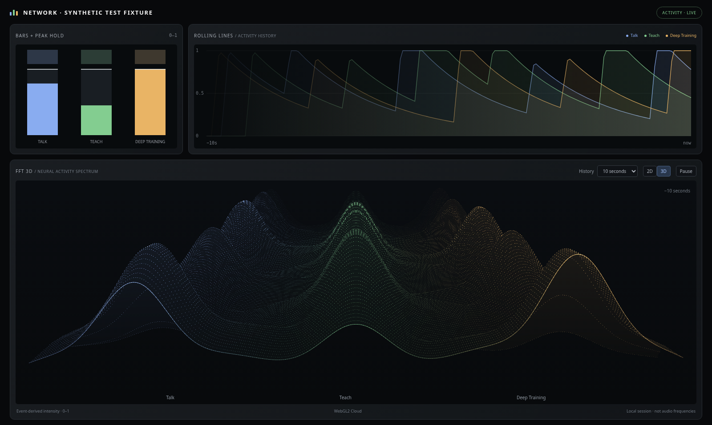
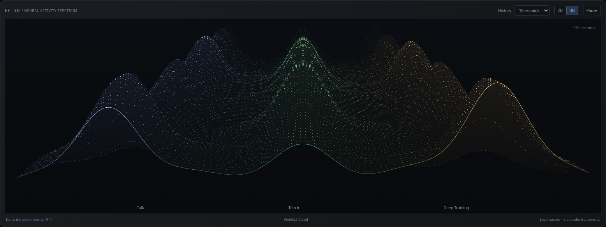
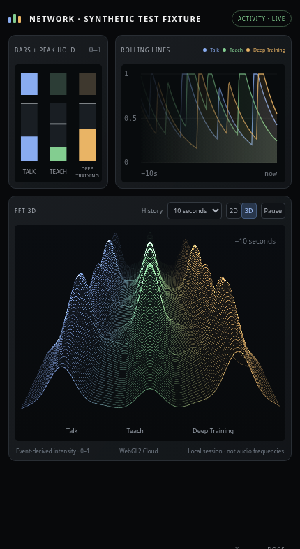

# Network V2 and bounded research accounting

Base: `2239809` (merged PR #135). No live model/search calls, credentials, production data access or deployment were used for this change.

## Confirmed incident cause

The supplied November 6 log reports three distinct hosted-tool IDs: two completed and one nonterminal. The overall Responses response was completed. These are different levels of completion; an overall completed envelope does not prove that every tool ran to completion.

`accountTools()` in `src/server/research-tool-accounting.cjs` previously rejected `calls.length > ceiling` as `RESPONSE_PARSE_ERROR / TOOL_BUDGET_EXCEEDED`. This ran before source extraction in `research-information.cjs`, explaining `sourceCount: 0`. HTTP 200 described the upstream HTTP exchange, not acceptance of evidence by Mindling. The provided metadata cannot establish whether the third operation was queued, ignored at the cap, dispatched or billed. No raw production response was available. The deterministic fixture reproduces the reported counters; it is not a replay of the unavailable response.

The request already uses the provider's `max_tool_calls: 2`, hosted `web_search`, `tool_choice: auto`, non-streaming JSON and the existing output-token limit. The public [Responses SDK contract](https://github.com/openai/openai-python/blob/main/src/openai/types/responses/response_create_params.py) documents `max_tool_calls` as a total built-in-tool processing limit, with further attempts ignored. This is the strongest existing request-level control; the patch does not falsely claim to cancel a third invocation after dispatch or infer billing from IDs.

The updated accounting distinguishes:

- Same-ID lifecycle observations: merge compatible transitions; do not count another invocation.
- Conflicting identities/statuses or ambiguous anonymous excess: `INVALID_TOOL_ACCOUNTING`.
- More than two terminal distinct invocations: `TOOL_BUDGET_VIOLATION / TOOL_BUDGET_EXCEEDED`.
- Two terminal invocations plus an extra unfinished ID: `TOOL_LIFECYCLE_INCOMPLETE / TOOL_LIMIT_OUTCOME_UNKNOWN`.
- Unfinished work within the ceiling: `TOOL_LIFECYCLE_INCOMPLETE`.

New numeric diagnostics are requested limit, reported calls, duplicate observations, terminal calls and calls with uncertain dispatch/completion. They contain no query, prompt, source text, memory content or provider response. Existing structured error transport carries the exact category to the client and persisted task. These rejected provider results still return HTTP 502, now with a specific contract failure rather than a generic parse error. Invalid JSON and transport errors retain their own existing classifications.

No evidence is accepted from these uncertain/over-budget responses. No synthetic checkpoint is created. Reservations remain intact and both automatic and explicit retries are refused. Existing signed-checkpoint evaluation-only recovery for other eligible failures remains unchanged. A genuine overrun is not hidden, refunded or described as successful learning.

## Clarification and recovery

`understandInput()` and the actual clarification continuation preserve `seria A, italian league` as the subject and `Basic rules` as scope detail. `publicResearchTopic()` combines both; no league facts, spelling mapping or forced memory links were added. Existing canonical evidence, deduplication and integration rules remain responsible for learning.

The confirmed recovery defect was the `reviewedTopics` in-memory Map. An approved public replacement for a sensitive topic could disappear before execution on reload. The replacement is now stored atomically on the existing task as `approvedPublicTopic` (version, query key, topic, approval timestamp). It is revalidated when read, bound to the task query, and removed when clarification changes that query. No database migration is needed. Fresh Settings authorization and grant revision are still required for saving and dispatching. The original private request remains local; only the validated public topic enters planning/search.

Scheduler cooldown and individual research errors are intentionally separate: the existing scheduler does not attribute a manual task failure to an unrelated automatic task. A real ten-minute cooldown remains valid, while the failed task retains its precise accounting diagnosis. Automatic limits remain four inference reservations per task, two hosted calls, four model requests, at most three accepted memories, two-Energy readiness, zero extra Energy for automatic research and the separate semantic allowance.

## Network V2

Exactly three visualization cards replace the binary stream and agent placeholders. Existing event journal and Settings semantic diagnostics are retained, but Network no longer projects binary logs or agent cards.

`Dashboard` forwards the existing `NEURAL_INPUT` event to one read-only `ActivityModel`. Talk, Teach and Deep Training retain their originating request channel; duplicates are ignored by request ID and phase. The research completion notification now uses the task's actual activity instead of hardcoded Teach and marks autonomous initiations. Autonomous background tasks are excluded from these three user-activity channels. No new research, inference, storage reads or writes are initiated by opening Network.

This is local-session event history, not stored memory counts, audio FFT, CPU utilization or an intelligence score. Reload starts an empty activity session rather than inventing current activity from old/simulated timestamps. All charts are empty/flat until real events arrive. The screenshots use explicitly labelled synthetic events, never production memories or automatically generated app data.

### Deterministic normalization

For event age `a` seconds, its contribution is:

`weight × min(1, a / 0.16) × exp(−max(0, a − 0.16) / 1.65)` for `0 ≤ a < 12`; otherwise zero.

Weights: start `0.62`, accepted `1.0`, cancelled `0.22`. Cancellation represents real processing ending, not knowledge acquisition. Contributions are summed per channel and clamped to `[0,1]`. These are presentation weights, not measured workload or model performance.

A 601-sample timestamped ring holds 30 seconds at 20 Hz. History controls select 5/10/20/30 seconds. Bounds: 512 retained events, 512 request-channel mappings and 1,024 deduplication keys. Peak indicators take the maximum over the last three seconds, holding 1.6 seconds before exponential release. Onset lights last 450 ms. Bars, history and cloud all use the same underlying channel function. Pause freezes only the visualization; research and event receipt continue.

### Cloud rendering

The WebGL2 renderer uses a fixed 320 × 180 mesh, a faint depth-tested matte surface, 57,600 colored points, a foreground rim, perspective compression and depth fading. A bounded spatial kernel spreads each of the three real channel intensities across its region. History recedes into depth; interpolation never writes to activity records or canonical knowledge. There are no random event peaks or sine-wave idle animations.

Canvas provides a lower-cost ridge surface for 2D mode, unavailable WebGL2 or context loss. Context restoration rebuilds GPU resources. One view-owned animation loop draws at up to 30 fps (15 fps on narrow panels), with DPR capped at 1.5. Hidden views/tabs, paused visualization and reduced-motion preference stop continuous frames; empty/expired history stops the loop as well. Resize, visibility and media listeners and GPU buffers/programs are cleaned up on teardown.

Projection, cloud layering, color treatment, meters and rolling-line presentation are adapted from [Realtime_PyAudio_FFT, rust-engine](https://github.com/aiXander/Realtime_PyAudio_FFT/tree/rust-engine). Full MIT copyright/license is retained in `third_party/realtime-fft-LICENSE.txt`. Audio devices, filters, other panels, sockets and server code are not imported. No dependencies or CSS shadows were added.

## Visual review

The rendered desktop and narrow screenshots were inspected against the supplied reference. The three-card layout preserves graphite panels, near-black plots, compact headings, blue/green/amber traces, vertical peak meters and the dominant receding cloud. Mobile labels use a two-line Deep Training label to avoid clipping. The event-driven terrain is intentionally smoother than an audio spectrum and does not invent spectral detail to mimic sound measurements.

## Verification

Results:

- Focused Node suite: **61/61 passed** (`network-v2`, `research-tool-accounting`, `production-research-502`, `intelligence-network`, `live-research-diagnostics`, `limitation-recovery`).
- Existing received-success suite: **25/25 passed** separately on this branch and unchanged main.
- Full Node suite: **432 tests, 384 passed, 48 failed**. Unchanged main: **421 tests, 372 passed, 49 failed**. All 48 final failures match baseline names. The removed failure was a stale expectation that compatible same-ID lifecycle events must conflict; its corrected regression now verifies valid merging and genuinely conflicting terminal states.
- An earlier full run also intermittently failed “receipt transaction failure preserves the known server outcome” (observed task state PLANNING). It passed in isolated runs on both branches and the subsequent full run. Its intermittent cause has not been proven; it is not being silently counted as a confirmed pre-existing failure.
- Three Chromium suites pass in both normal and Stage Preview: `network-v2-browser.py`, `intelligence-network-browser.py`, and `tool-accounting-browser.py`.
- Static syntax checks and `git diff --check` pass. No dependencies, paid calls or production data were used.

Commands use `node --test tests/*.test.mjs` for full comparison, and `MINDLING_TEST_URL=http://127.0.0.1:8769 python tests/<suite>.py` with a local static server for Chromium. Focused Node tests exercise accounting, HTTP error serialization, exact diagnostic validation, safe retry rules, clarification continuation, query binding, normalization, timestamps and original Deep provenance. Chromium uses isolated normal/preview IndexedDB stores, mocked transport and local-only requests; it covers approved-topic rehydration, reservations, no duplicate dispatch, unchanged memories/Energy/XP/identity, Dashboard event forwarding, navigation, context loss/restoration, fallback, reduced motion, hidden views/tabs, idle decay and GPU teardown.

## Production verification and limits

1. Deploy the reviewed PR normally; do not reset the Mindling or its stored tasks.
2. Submit a newly authorized public research request, preserving its clarification. Do not automatically repeat the previously uncertain request.
3. Inspect correlation-matched diagnostics: requested limit 2, distinct/terminal/incomplete counters and exact error category. Confirm successful evidence is accepted only within all existing completion/provenance checks.
4. If an extra nonterminal ID recurs, obtain provider metadata for that correlation/request ID. Only provider investigation can establish whether it was ignored, dispatched or billed. This patch deliberately leaves the task blocked rather than accepting uncertain partial evidence.
5. Review a public replacement topic, reload before dispatch, and confirm it resumes only under the currently enabled authorization. Verify the original sensitive wording is not sent to search.
6. Use normal Talk/Teach/Deep interactions, then open Network. Check channel identity and idle decay. Opening the page itself must make no API request.

Live production success and provider hard-cap compliance are not established by these offline tests. No paid model calls or production deployment were performed.
