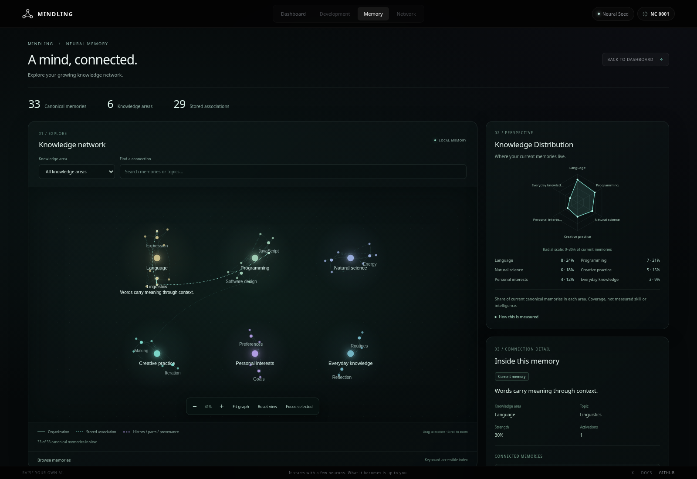
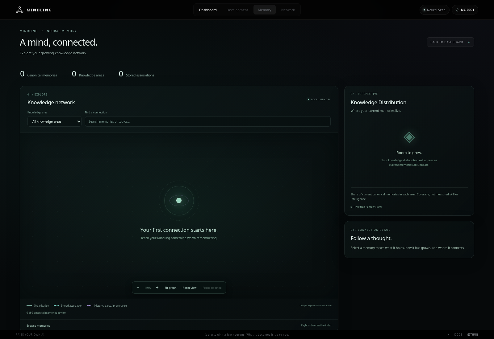

# M3 — Neural Memory Visualization

## Scope and existing architecture

Built from main `9e86199`. The original Memory view was `Dashboard.#renderMemoryDevelopment` → `renderKnowledge`, displaying all records as nested technical lists plus a prominent development percentage. Gameplay and Stage Preview already hydrate memory arrays through `MindlingDatabase` / `PreviewStore`; the Dashboard receives committed state through existing rendering/events. No additional storage opener or persistence path is needed for a read-only visualization.

The replacement reuses the application's existing Memory navigation, shell, typography token, dark surfaces and Dashboard lifecycle. It provides a dominant Canvas knowledge network, compact SVG Knowledge Distribution radar, accurate counters, controls and a contextual inspector. It is a desktop workspace; compact browser windows retain a scrollable desktop layout. No mobile redesign or dependency/build/backend change is introduced.

`src/memory/graph-data.js` is the DOM-free read-only projection and deterministic layout. `src/memory/neural-memory-view.js` owns Canvas/SVG rendering, controls and inspector. Dashboard owns one instance and supplies the same committed state it already renders. The old DOM list renderer and sandbox-specific DOM decoration are no longer used; the pure legacy `knowledgeGroups` helper remains compatible with its native consumers/tests.

## Data mapping and counters

- One memory node per unique nonempty saved string ID. Namespaced graph IDs distinguish memory, area and topic identities. Missing/duplicate IDs are skipped with a notice; underlying records are neither changed nor deleted. Missing optional text/category/topic metadata gets an explicitly unavailable/uncategorized display label.
- An area uses its stored category ID when present; otherwise its existing category/area label. A topic uses the existing topic/concept label within that area. These are organizational nodes, not new persisted memories or inferred knowledge.
- Canonical memory count is the number of unique valid memory records. Embedded `parts`/`atomicParts` are inspector content, not new canonical nodes. An existing record containing three statements still counts as one. Independently stored atomic child records each count as a canonical memory because the actual data model explicitly persists them separately.
- Historical original compounds remain visible, connected to real children through `parentMemoryId` and `componentMemoryIds`. `supersededBy` / `supersededByIds` show history relationships. Current/historical status comes from existing flags. `valueHistory` stays within the record inspector rather than inventing additional canonical memories.
- `relatedMemoryIds` produces descriptive association edges; `coSubmittedMemoryIds` produces provenance edges. No text similarity, model classification or guessed connection is used. Self-links, dangling references and duplicate references are ignored safely.
- The header's association count is the number of distinct existing memory pairs referenced by these stored relationship fields, counted once even when reciprocal or represented by several kinds. Category/topic hierarchy edges are excluded. The inspector retains each actual relationship kind.

Connections use different line patterns as well as color: solid hierarchy, short-dash descriptive association and dash/dot explicit history/parts/provenance. All are organizational/recorded relationships, not evidence that a player claim is true. A single global note explains this; repeated per-node disclaimers are removed.

## Radar metrics and scientific limits

There are no reliable measured skill assessments in the inspected data model. The chart therefore says **Knowledge Distribution**, not reasoning, intelligence or demonstrated proficiency.

For each area:

```text
share = current canonical memories in that area / all current canonical memories
```

Strength, activation counts, XP, Energy and text interpretation do not affect it. Historical records are excluded from current coverage. With more than six areas, the five largest retain separate axes and the remainder form an explicitly described Other areas axis. With fewer than three actual areas, the UI shows real counts and a waiting state, rather than fabricating axes to make a polygon.

The outer ring is a clearly labelled share scale rounded up to the next ten percentage points, not a 100% skill target. Actual percentages and counts appear in the legend and hover titles; display percentages are rounded. The collapsed method explanation states the formula, grouping, scale, exclusion of historical records and absence of measured proficiency. No comparison layer is shown because there is no genuine second dataset.

## Interaction and inspector

Mouse-wheel zoom is anchored at the pointer; drag pans, with a five-pixel threshold preventing accidental selection. Canvas hit testing selects actual nodes and shows hover text. Arrow keys pan, plus/minus zoom, and zero fits the graph. Fit/reset/focus controls and area/search filters are normal labelled HTML controls. A paginated keyboard-accessible memory index provides selection independent of Canvas. Related-memory buttons focus the saved node and clear an incompatible filter when necessary.

The default inspector shows actual text, area, topic, strength, activations, status, connected records and expandable previous values/conflicting claims. Embedded recorded parts can be inspected without inflating counts. Technical ID/classification/verification/source/neural references/raw association data sit in collapsed Advanced details. All stored text is rendered with `textContent` or Canvas/SVG text, never interpolated into executable HTML. The adapter does not change verification/classification metadata.

## Rendering and performance

Layout is deterministic for the same data, including reordered record arrays: sorted area/topic clusters and phyllotactic memory positions. It uses indexed groupings and sorting, not a continuous physics simulation. New data may repack clusters; stable record IDs preserve selection and identity. Labels are density-limited, and the full text remains accessible in the inspector/index.

Rendering is demand-driven: navigation, relevant memory changes, resize or interaction schedule at most one frame. Life/Energy-only updates are excluded by a presentation-field signature. Hidden views/pages do not animate. Teardown explicitly removes the document listener, aborts owned listeners, disconnects ResizeObserver, cancels frames, invalidates pending builds and releases caches/Canvas backing storage. Reduced motion disables transitions; there is no continuous graph animation.

For large datasets, all memory nodes remain represented, with batched overview dots, viewport culling and simplified fine hierarchy edges at distant zoom. Extra associations are highlighted for selection rather than painting dense unreadable curves everywhere. The interface explains this behavior. Filtering/search and the paginated index retain access to every canonical record; no memories are sampled, invented or removed from storage.

On this cloud Chromium instance, the 5,000-record browser fixture prepared and displayed the graph in approximately 103 ms while an event-loop heartbeat continued. A separate phase measurement was about 33 ms projection, 7 ms filtering and 6 ms deterministic layout. These are local observations, not a guarantee for every machine or arbitrarily dense dataset. Very dense associations, many categories or long records can still require filtering/zoom. No worker, external library, model request or new infrastructure is required.

## Validation

```sh
node --test tests/*.test.mjs
# Run the existing static server, then:
python3 tests/neural-memory-browser.py
python3 tests/memory-transactions-browser.py
python3 tests/preview-energy-atomic-browser.py
python3 tests/sandbox-browser.py
python3 tests/network-energy-browser.py
python3 tests/evolution-browser.py
python3 tests/life-v2-browser.py
```

`MINDLING_TEST_URL` can select the existing local test server; `M3_SCREENSHOTS` selects screenshot output. New unit cases cover empty/corrupted data, one canonical memory with three embedded statements, real atomic children, categories/topics, actual/dangling/duplicate references, explicit relationship types, history, filtering, truthful coverage, deterministic layout, frozen-input nonmutation, stable updates and 5,000 records.

The new browser test uses real onboarding/hydration and actual persisted synthetic fixtures. It verifies mouse zoom/pan/click/hover, drag suppression, keyboard/index selection, inspector/history, cross-area links, filtering/search/reset, compact desktop width, rehydration, successful native learning updates, hidden/idle behavior, resource teardown and large data. It snapshots all existing IndexedDB stores before/after Memory interactions and asserts byte-for-byte equality, including Energy and reward journals, while intercepting API requests and asserting none. Existing gameplay browser tests now select the inspector instead of asserting on the removed technical-list DOM; their learning/transaction assertions remain intact.

No production learning, service/API/model configuration, classification, Energy, XP/reward rule or IndexedDB schema is changed. There is no reset or migration of player memories. No paid model calls are made. The GitHub integration may create a PR preview; this task does not merge or deploy directly to production.

## Screenshots

These screenshots use the explicitly synthetic **persisted browser fixture**, not invented product defaults or private player data. The product never imports or seeds the fixture automatically.





Final results: **199/199 Node tests passed** (15 new adapter/layout cases; zero failed/skipped). The new M3 browser suite and all six relevant existing Chromium suites passed. The final large-data run displayed 5,000 canonical records in **93.9 ms** with 13 event-loop heartbeats; hidden-state updates resumed correctly. Entire-store snapshots remained equal through visualization interactions, with zero captured API calls. `git diff --check` passed. No production learning/service/storage/Energy/XP code was changed.
